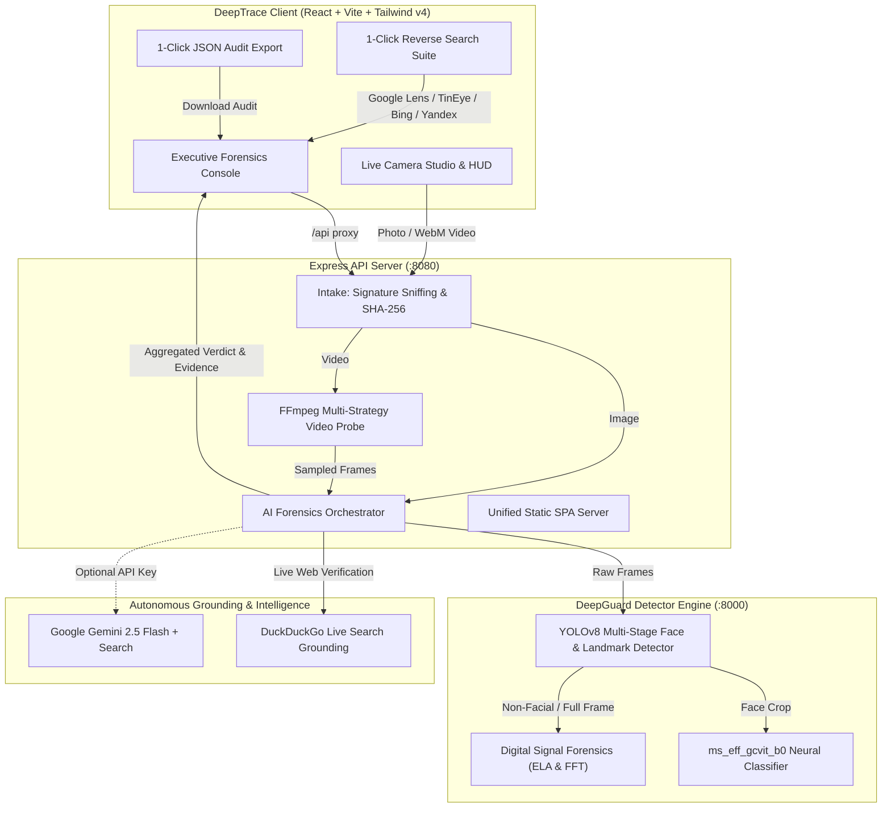

# DeepTrace AI (v0.7 PRO)
### Neural Media Forensics, Multimodal AI & Live Web Search Grounding

[](https://github.com/madarazorodevop/Deeptrace)
[](https://nodejs.org)
[](https://python.org)
[](https://fastapi.tiangolo.com)
[](https://pytorch.org)
[](LICENSE)

DeepTrace AI is a next-generation neural media forensics and provenance verification console designed to detect deepfakes, synthetic face replacements, generative media artifacts, and unverified digital content. Combining deep neural network classifiers (**DeepGuard**), full-frame frequency domain forensics (**ELA & FFT**), autonomous web search grounding, and optional **Google Gemini 2.5 Flash** multimodal intelligence, DeepTrace provides comprehensive, explainable digital verification for photos, recorded videos, and live camera streams.

> **Forensic Review Notice:** DeepTrace is a rigorous preliminary analysis and investigation tool. Tool observations, file integrity hashes, spectral anomalies, and neural model signals are presented transparently alongside provenance context.

---

## Architecture Overview



---

## Key Features

### 1. Neural Deepfake & Generative Classifier
- **DeepGuard Engine**: Multi-scale hybrid backbone (`ms_eff_gcvit_b0`) trained on FaceForensics++ (`ff++`).
- **Multi-Stage Face Detection**: Ultralytics YOLOv8 face detector with dynamic fallback thresholds for angled, low-light, or webcam imagery.
- **Landmark Alignment & 20% Margin Cropping**: Facial bounding boxes are standardized for neural evaluation.

### 2. Full-Frame Signal Forensics (ELA & FFT)
- **Error Level Analysis (ELA)**: Detects compression quantization variances and re-saved manipulation regions.
- **2D Fourier Transform (FFT)**: Identifies synthetic checkerboard frequencies and diffusion noise artifacts.
- **Laplacian Variance**: Measures micro-texture sharpness and synthetic blur halos.
- **Non-Facial Fallback**: Automatically evaluates digital forensics even when no human faces are present in the image or video.

### 3. Autonomous AI Grounding & Live Web Search
- **DuckDuckGo Web Search Grounding**: Automatically searches the public web for media origin, subject documentation, and archival verification records.
- **Google Gemini 2.5 Flash Multimodal**: Direct integration with Google Search Grounding for reasoning, context verification, and deepfake debunking.
- **1-Click Reverse Visual Search Suite**: Instant external cross-referencing tools:
  - **Google Lens** (Object detection & visual web sources)
  - **TinEye** (Earliest publication date & modified version tracking)
  - **Bing Visual Search** (Microsoft Copilot visual matching)
  - **Yandex Images** (Facial recognition & Russian/CIS provenance)

### 4. Live Camera Studio with Biometric HUD
- Real-time webcam viewport with animated biometric scanline reticles and telemetry overlay.
- High-resolution single-frame forensic snapshot capture.
- In-browser WebM video clip recording with timer and direct pipeline submission.

### 5. Resilient Multi-Strategy Video Duration Recovery
- Resolves browser-streamed WebM/fMP4 recordings (`MediaRecorder`) that lack finalized container duration headers.
- Multi-tier recovery:
  1. Matroska container stream tags (`DURATION`, `DURATION-eng`).
  2. Frame-count / timebase derivation (`nb_frames / fps`).
  3. Zero-overhead null-muxing packet probe (`ffmpeg -c copy -f null -`) in `< 10ms`.
  4. OpenCV `cv2.VideoCapture` frame iteration fallback.

### 6. Multi-Device Local Network Hosting (`0.0.0.0`)
- Binds to all network interfaces (`0.0.0.0`) with dynamic private subnet CORS (`192.168.*`, `10.*`, `172.16-31.*`).
- Access from mobile phones, tablets, or other workstations on your local Wi-Fi without configuration.
- Unified single-port hosting: Express serves both production client assets and API endpoints simultaneously on port `8080`.

### 7. Executive Forensics Console & JSON Audit Export
- One-click downloadable JSON audit report with timestamp, SHA-256 integrity hash, model diagnostics, and web references.
- High-fashion fluid obsidian and neon rim-lit dark aesthetic with frosted glass telemetry panels.

---

## Prerequisites

- **Node.js**: `20.19` or newer (Node.js 22+ recommended)
- **Python**: `3.10+` (tested on Python 3.11, 3.12, 3.13, 3.14)
- **FFmpeg & ffprobe**: Required on system `PATH`
- **Git**

### Installing FFmpeg

- **Linux (Ubuntu/Debian)**:
  ```bash
  sudo apt update && sudo apt install -y ffmpeg
  ```
- **Linux (Arch/Manjaro)**:
  ```bash
  sudo pacman -S ffmpeg
  ```
- **macOS (Homebrew)**:
  ```bash
  brew install ffmpeg
  ```
- **Windows (winget)**:
  ```powershell
  winget install Gyan.FFmpeg
  ```

---

## Quick Start & Installation

### 1. Start the Python DeepGuard Detector Service

From the repository root:

```bash
# Create and activate Python virtual environment
python3 -m venv detector/.venv
source detector/.venv/bin/activate       # On Windows: detector\.venv\Scripts\activate

# Install dependencies
pip install --upgrade pip
pip install -r detector/requirements.txt

# Start detector service on port 8000
python3 -m uvicorn main:app --app-dir detector --host 127.0.0.1 --port 8000
```

Verify detector health:
```bash
curl http://127.0.0.1:8000/health
```

### 2. Start the Express API Backend

In a second terminal:

```bash
cd server
npm install
npm run dev
```

Verify backend health:
```bash
curl http://localhost:8080/api/health
```

### 3. Start the React Frontend

In a third terminal:

```bash
cd client
npm install
npm run dev
```

Open **`http://localhost:5173`** in your browser.

---

## Multi-Device Local Network Hosting

To access DeepTrace from a phone, tablet, or another computer on the same Wi-Fi network:

1. Identify your computer's local IP address:
   ```bash
   # Linux/macOS
   ip route get 1.1.1.1 | awk '{print $7}'
   # Windows
   ipconfig
   ```
   *(Example local IP: `172.18.229.12`)*

2. Open the URL in any browser on your Wi-Fi:
   - **Vite Dev Server**: `http://<your-local-ip>:5173`
   - **Production Express Server**: `http://<your-local-ip>:8080`

---

## Environment Configuration

Copy `.env.example` to `.env` in the root or `server/` directory:

```bash
cp .env.example .env
```

| Variable | Default | Purpose |
| :--- | :---: | :--- |
| `PORT` | `8080` | Express listener port |
| `CLIENT_ORIGIN` | `http://localhost:5173` | Comma-separated CORS allowlist (local subnets automatically permitted) |
| `MAX_FILE_MB` | `50` | Maximum upload size hard cap |
| `MAX_IMAGE_MB` | `20` | Image-specific upload limit |
| `MAX_VIDEO_MB` | `50` | Video-specific upload limit |
| `MAX_AUDIO_MB` | `50` | Audio-only upload limit |
| `MAX_DURATION_SEC` | `60` | Video duration limit |
| `DETECTOR_MODE` | `real` | `real` (DeepGuard connected) or `disabled` |
| `DETECTOR_BASE_URL` | `http://127.0.0.1:8000` | Detector endpoint URL |
| `DETECTOR_TIMEOUT_MS` | `300000` | Detector inference timeout (5 minutes) |
| `FFMPEG_PATH` | `ffmpeg` | FFmpeg binary path |
| `FFPROBE_PATH` | `ffprobe` | ffprobe binary path |
| `GEMINI_API_KEY` | *(Optional)* | Google Gemini API key for live multimodal analysis |
| `GEMINI_MODEL` | `gemini-2.5-flash` | Gemini model ID |

> **Tip:** You can enter your Gemini API key directly into the in-app **AI Settings modal** without saving it to disk or `.env`.

---

## API Reference

### Express Gateway (`http://localhost:8080`)

#### `GET /api/health`
Returns service status and timestamp.

#### `POST /api/analyze?aggMode=conf|mean|vote`
Multipart file upload in field `media`.
- **Headers (optional)**: `x-gemini-api-key: <key>`
- **Query parameters**:
  - `aggMode`: Temporal aggregation mode (`conf` [default], `mean`, `vote`).
  - `useAi`: Enable/disable AI search grounding (`true` [default]).
- **Supported Formats**:
  - Images: `.jpg`, `.jpeg`, `.png`, `.webp`
  - Videos: `.mp4`, `.m4v`, `.mov`, `.avi`, `.mkv`, `.webm`
  - Audio: `.wav`, `.mp3`, `.m4a`, `.aac`, `.flac`, `.ogg` *(returns explicit incomplete finding)*

### Detector Service (`http://127.0.0.1:8000`)

- `GET /health` — Detector model & hardware state.
- `POST /analyze/image` — Direct single-image facial and spectral evaluation.
- `POST /analyze/video?sample_fps=1` — Direct multi-frame video prediction.

---

## Testing & Quality Assurance

Run the comprehensive unit test suite:

```bash
cd server
npm test
```

Tests cover:
- Temporal score aggregations (`conf`, `mean`, `vote` branch logic)
- Strict media magic signature sniffing & MIME integrity validation
- SHA-256 byte hashing accuracy
- Audio-only explicit incomplete result compliance
- Upload bounds and duration constraints

Build the production client:
```bash
cd client
npm run build
```

---

## Score Interpretation & Forensic Semantics

| Indicator | Meaning | Interpretation Guidance |
| :--- | :--- | :--- |
| **Fake Score** (`0.0 - 1.0`) | Raw neural sigmoid output for DeepGuard's fake class | **Uncalibrated heuristic.** `0.5` is not a 50% probability; a low score is not proof of authenticity. |
| **Analysis Type** | `facial_deepfake` or `visual_forensics_non_facial` | Declares whether facial features or full-frame signal forensics were measured. |
| **ELA Mean / Std** | Error Level Analysis compression variance | Higher discrepancy suggests localized digital splicing or resaving. |
| **FFT High-Freq Ratio** | Spectral energy distribution | Elevated ratios indicate high-frequency synthetic artifacts common in diffusion/GAN models. |
| **Web Grounding** | Reverse search & live public web provenance | Matches verified online documentation, archival records, or fact-checkers. |

---

## Contributors

- **madarazorodevop** ([@madarazorodevop](https://github.com/madarazorodevop)) — Project Owner & Lead Maintainer
  - Project conception, core vision, repository architecture, and specifications
  - Technical requirements, pipeline review, and overall release orchestration

- **Nandhakumar** ([@NANDHAKUMAR-360](https://github.com/NANDHAKUMAR-360)) — Core Contributor & Full-Stack Developer
  - Scaffolding and setup of DeepTrace client, Express server, and initial microservices architecture
  - Integration of DeepGuard neural detector pipeline and early visual forensics engine
  - Laptop system camera integration, preview stabilization, and face detection decoupling

- **Kishore Kumar V** ([@Kishore-kumar-007](https://github.com/Kishore-kumar-007)) — Core Contributor & System Architect (v0.7.0 PRO)
  - Designed & engineered Multimodal AI Forensics & Live Web Search Grounding (`webSearchService.js`, `geminiService.js`, `aiOrchestrator.js`)
  - Engineered Live Camera Studio with Biometric HUD & Clip Recording (`LiveCameraStudio.jsx`)
  - Architected Executive Forensics UI, AI Grounding Panel, 1-Click Reverse Search Suite, and JSON Audit Export
  - Implemented multi-strategy video duration recovery & streaming WebM frame extraction for unindexed recordings
  - Enabled multi-device local network hosting on `0.0.0.0` with dynamic subnet CORS and unified single-port static serving
  - Designed luxury fluid obsidian and neon rim-lit dark UI aesthetic

---

## License

- **DeepTrace Core Application**: [MIT License](LICENSE)
- **DeepGuard Model Checkpoint**: MIT (as declared by the weight publisher)
- **Face & Landmark Detector**: Ultralytics YOLO runtime (AGPL-3.0)
