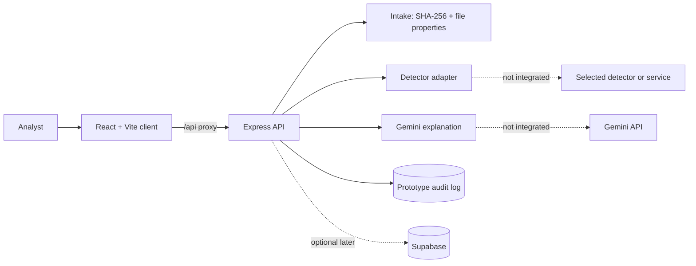

# DeepTrace AI

DeepTrace AI is an explainable media-forensics prototype for preliminary review of video and audio. It is being built for a 24-hour hackathon. The goal is to keep tool observations, file properties, timestamps, and integrity records separate from AI interpretation, and to state what cannot be concluded.

> **Preliminary review tool. Not a substitute for qualified forensic examination.**

This repository is currently a **Phase 0 scaffold**. It contains a React/Vite client shell and an Express API skeleton. Uploads, media extraction, detector integration, Gemini explanations, Supabase, and the report UI are not implemented.

## Architecture



The detector is a purpose-built media-analysis method, not Gemini. Gemini may only explain findings supplied to it. SHA-256 is recorded at intake for byte-integrity comparison; it does not establish authorship or original authenticity.

## Prerequisites

- Node.js 20.19 or newer and npm
- Git
- Python 3.10+ only if a local detector is selected
- `ffmpeg` and `ffprobe` before media analysis is enabled
- Optional: Docker, Supabase, and a hosted detector account

`ffmpeg` and `ffprobe` are not installed in the current development environment. On Windows, the expected install command is:

```powershell
winget install Gyan.FFmpeg
```

Close and reopen the terminal after installation, then verify with `ffmpeg -version` and `ffprobe -version`.

## Environment

Copy `.env.example` to `.env` in the project root and fill only what is needed. The server loads `server/.env` first if it exists, otherwise the root `.env`. Never commit `.env` or any secret.

| Variable | Default | Purpose |
| --- | --- | --- |
| `PORT` | `8080` | Express listener port |
| `CLIENT_ORIGIN` | `http://localhost:5173` | Comma-separated CORS allowlist |
| `MAX_FILE_MB` | `50` | Planned upload size limit |
| `MAX_DURATION_SEC` | `60` | Planned media duration limit |
| `RETENTION_MINUTES` | `60` | Planned temporary-file retention |
| `MAX_CONCURRENT_JOBS` | `2` | Planned analysis concurrency |
| `GEMINI_API_KEY` | empty | Server-only; not used in Phase 0 |
| `GEMINI_MODEL` | empty | Pin an exact model ID when Gemini is added |
| `DETECTOR_MODE` | `disabled` | `real`, `demo`, or `disabled`; stays `disabled` until a detector is verified |
| `DETECTOR_NAME` | empty | Selected detector identifier |
| `DETECTOR_API_KEY` | empty | Server-only detector credential |
| `DETECTOR_BASE_URL` | empty | Detector endpoint, if applicable |
| `SUPABASE_URL` | empty | Optional, server-only |
| `SUPABASE_SERVICE_KEY` | empty | Optional, server-only |

`GEMINI_MODEL` is intentionally blank. Do not use a `latest` alias; pin the exact ID after verification.

## Run locally

Server:

```powershell
cd server
npm install
npm run dev
```

Client:

```powershell
cd client
npm install
npm run dev
```

Open `http://localhost:5173`. The Vite dev server proxies `/api` to `http://localhost:8080`.

Health check:

```powershell
Invoke-RestMethod http://localhost:8080/api/health
```

## API

Implemented:

- `GET /api/health` — liveness check.

Planned, not implemented:

- `POST /api/cases` — upload media, create a case, start analysis.
- `GET /api/cases/:id/status` — per-stage progress.
- `GET /api/cases/:id/report` — structured report.
- `GET /api/cases/:id/log/verify` — verify the prototype event-log chain.
- `GET /api/cases/:id/export.json` and `GET /api/cases/:id/export.html` — export.
- `POST /api/cases/:id/reverify` — re-hash a retained file and compare digests.
- `DELETE /api/cases/:id` — remove case files and records.

Errors use the shape `{ "error": { "code": "string", "message": "string" } }`.

## Detector status

No detector is integrated. Detector selection is gated on verification.

Research on the DeepGuard candidate referenced in the implementation plan indicates that `HanMoonSub/DeepGuard` is an open-source, locally run image/video frame classifier with MIT-licensed code and published checkpoints. It is not a verified hosted API. It does not analyze audio. The repository's own web app is a self-hosted FastAPI/React stack, not a public detector service. No accuracy, latency, or hardware claims are made here; those must be measured after selection.

A single service that genuinely covers video, audio, and browser-frame analysis has not been confirmed. If no compliant single service is selected, the options are to report the gap or add a separately documented second detector with the user's approval.

## Limitations

- This is a prototype audit log, not a legally admissible chain of custody.
- SHA-256 proves byte integrity only. It does not prove authorship, provenance, or that media was authentic when created.
- Missing metadata is treated as unknown, never suspicious by itself.
- No definitive verdict is displayed. Findings are observations for review; interpretations are labeled separately.
- No accuracy, latency, or dataset claims are made. Evaluation has not been run.
- Media samples, `.env` files, generated frames, model weights, and temporary files must not be committed.
- Uploads, ffmpeg processing, detector calls, Gemini calls, Supabase, and webcam capture are not implemented in Phase 0.

## Evaluation

TO BE FILLED AFTER TESTING
