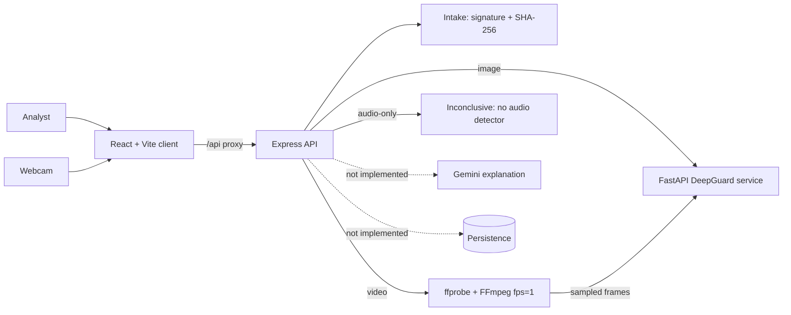

# DeepTrace AI

DeepTrace AI is an explainable media-forensics prototype for preliminary review of images, video, and audio. It is being built for a 24-hour hackathon. The goal is to keep tool observations, file properties, timestamps, and integrity records separate from interpretation, and to state what cannot be concluded.

> **Preliminary review tool. Not a substitute for qualified forensic examination.**

Current status: **Phase 3 partial prototype**. Image and video uploads are analysed locally by DeepGuard. The client can capture a single webcam photo for image analysis. Audio-only uploads return an explicit incomplete result because no audio detector is configured. Gemini explanations, persistence, the audit log, report export, and continuous webcam analysis are not implemented.

## Architecture



DeepGuard is the detector. Gemini is not a detector and is not connected yet. SHA-256 is recorded at intake for byte-integrity comparison; it does not establish authorship or original authenticity.

## What works

- Image upload and DeepGuard image analysis.
- Single-photo webcam capture in the browser; the captured frame follows the same image pipeline.
- Video validation with `ffprobe`, FFmpeg `fps=1` frame extraction, and one DeepGuard image analysis per sampled frame.
- Timestamped frame-level observations and `conf`, `mean`, or `vote` aggregation.
- SHA-256 and file properties recorded at intake.
- Strict extension, MIME, magic-signature, size, and duration checks.
- Temporary upload and frame cleanup after each request.
- Audio-only uploads produce `No audio detector configured — analysis incomplete`.
- Raw detector output and uncertainty notes are shown in the UI.

Not implemented: Gemini explanation, persistence, prototype audit log, report/export, continuous webcam analysis, audio detector.

## Prerequisites

- Node.js 20.19 or newer and npm
- Python 3.10+ (the current environment uses Python 3.13)
- Git
- FFmpeg and ffprobe on `PATH`
- Sufficient disk space for Python packages and the DeepGuard checkpoint

On Windows, FFmpeg can be installed with:

```powershell
winget install Gyan.FFmpeg
```

Close and reopen the terminal after installation, then verify:

```powershell
ffmpeg -version
ffprobe -version
```

## Setup

### 1. Detector service

From the project root:

```powershell
python -m venv detector/.venv
detector\.venv\Scripts\python.exe -m pip install --upgrade pip
detector\.venv\Scripts\python.exe -m pip install -r detector/requirements.txt
detector\.venv\Scripts\python.exe -m uvicorn main:app --app-dir detector --host 127.0.0.1 --port 8000
```

The service binds to `127.0.0.1` only. The first analysis downloads the checkpoint to `%USERPROFILE%\.cache\torch\hub\checkpoints` and can take longer than later requests.

Health check:

```powershell
Invoke-RestMethod http://127.0.0.1:8000/health
```

Optional detector environment variables are `DEEPGUARD_MODEL` (default `ms_eff_gcvit_b0`), `DEEPGUARD_DATASET` (default `ff++`), `DETECTOR_PORT` (default `8000`), `DETECTOR_MAX_IMAGE_MB`, `DETECTOR_MAX_VIDEO_MB`, and `DETECTOR_MAX_DURATION_SEC`.

### 2. Express API

```powershell
cd server
npm install
npm run dev
```

### 3. Client

In a second terminal:

```powershell
cd client
npm install
npm run dev
```

Open `http://localhost:5173`. Vite proxies `/api` to `http://localhost:8080`.

### 4. Verification

Run the server unit tests:

```powershell
cd server
npm test
```

The tests cover aggregation modes, media signature and MIME validation, SHA-256 hashing, and the audio-only incomplete result. Build the client with:

```powershell
cd client
npm run build
```

### 5. Environment

Copy `.env.example` to `.env` in the project root or `server/.env`. Never commit `.env` or any secret.

| Variable | Default | Purpose |
| --- | --- | --- |
| `PORT` | `8080` | Express listener port |
| `CLIENT_ORIGIN` | `http://localhost:5173` | Comma-separated CORS allowlist |
| `MAX_FILE_MB` | `50` | Multipart upload hard cap |
| `MAX_IMAGE_MB` | `20` | Image-specific limit |
| `MAX_VIDEO_MB` | `50` | Video-specific limit |
| `MAX_AUDIO_MB` | `50` | Audio-only limit |
| `MAX_DURATION_SEC` | `60` | Video duration limit |
| `DETECTOR_MODE` | `real` | `real` or `disabled` |
| `DETECTOR_BASE_URL` | `http://127.0.0.1:8000` | Local detector; only localhost/127.0.0.1 allowed |
| `DETECTOR_TIMEOUT_MS` | `300000` | Detector request timeout |
| `FFMPEG_PATH` | `ffmpeg` | FFmpeg executable |
| `FFPROBE_PATH` | `ffprobe` | ffprobe executable |
| `GEMINI_API_KEY` | empty | Server-only; not used yet |
| `GEMINI_MODEL` | empty | Pin an exact model ID when Gemini is added |

The detector process reads its own environment; it does not read the Express `.env`. The defaults match the local setup.

## API

Express:

- `GET /api/health` — liveness check.
- `POST /api/analyze` — multipart field `media`; optional query `aggMode=conf|mean|vote`.
  - Images return an image-level fake-class score.
  - Videos return frame observations plus a video-level aggregate.
  - Audio-only files return HTTP 200 with `status: "inconclusive"`, `reason: "no_audio_detector"`, and the exact message `No audio detector configured — analysis incomplete`.

Detector:

- `GET /health`
- `POST /analyze/image` — multipart field `file`.
- `POST /analyze/video` — multipart field `file`; uses DeepGuard's built-in video predictor. The Express UI uses the FFmpeg pipeline instead, so direct and UI results can differ.

Errors use the shape:

```json
{
  "error": {
    "code": "string",
    "message": "string"
  }
}
```

## Detector pipeline

### Image

1. Express validates the extension, MIME type, magic signature, and size.
2. Express computes SHA-256 over the unchanged upload.
3. The file is sent to the local FastAPI service.
4. DeepGuard detects the largest face, applies a 20% crop margin, checks landmarks, resizes to 224×224, and returns a sigmoid output for the fake class.

### Video

1. Express validates the file and computes SHA-256.
2. `ffprobe` checks for a video stream, determines duration, and reads audio-stream count.
3. FFmpeg extracts approximately one JPEG frame per second.
4. Each frame is sent to the DeepGuard image endpoint independently.
5. Frame scores are aggregated using one of:

- `conf` (default): DeepGuard's custom heuristic. If more than 40% of frames score above 0.8, average those strong-fake frames. Otherwise, if more than 90% score below 0.2, average those strong-real frames. Otherwise average all frames.
- `mean`: arithmetic mean of all evaluated frame scores.
- `vote`: fraction of evaluated frames scoring above 0.5.

The video-level score is an aggregate of independent frame predictions, not temporal video understanding. Motion, frame-to-frame consistency, and audio are not modelled. `timestamp_seconds` is approximate source time from the first FFmpeg-extracted frame, not a frame-accurate forensic timestamp.

### Audio

No audio detector is configured. Audio-only files are not sent to DeepGuard and receive no audio score. The UI displays `No audio detector configured — analysis incomplete`. Videos may contain audio, but only their frames are analysed.

### Score semantics

- Label mapping: `0 = real`, `1 = fake`.
- The model returns a sigmoid output for the fake class.
- The score is uncalibrated. Do not read `0.5` as a confirmed 50% probability.
- A high or low score is not proof of manipulation or authenticity.
- If no usable face or valid prediction is available, the response status is `inconclusive`; no fallback score is invented.

## Detector status and licences

DeepGuard is not a hosted API. It is self-hosted through the Python package and a local FastAPI wrapper.

- Code: `HanMoonSub/DeepGuard`, MIT.
- Package: `deepguard==1.1.0`.
- Default checkpoint: `ms_eff_gcvit_b0` trained on `ff++`; published weights are declared MIT by the weight publisher.
- Runtime dependency: Ultralytics YOLO for face and landmark detection, **AGPL-3.0**.
- The face-detector weight `yolov8n-face.pt` is bundled with the DeepGuard source; its provenance is not separately documented in the inspected repository.
- The combined local runtime should therefore be treated as AGPL-3.0-sensitive. Do not redistribute the combined service without reviewing the obligations and the face-weight provenance.
- DeepGuard does not analyse audio.

The checkpoint is downloaded from the DeepGuard GitHub release specified by the package. The Hugging Face mirror used for label verification is `KoreaPeter/ms-eff-gcvit-deepfake-b0-kodf`.

## Measured smoke tests

These are sample checks, not an evaluation. They were run on 2026-10-22 on a Windows machine with an AMD Ryzen 7 7445HS, CPU-only `torch 2.14.1+cpu`; the RTX 3050 was not used because the installed PyTorch wheel is CPU-only.

Inputs were taken from the DeepGuard repository's `docs/samples` directory for functional verification only and were not committed. Their upstream dataset licensing was not independently verified; do not redistribute those samples.

| Input | Pipeline | Fake-class score | Aggregation | Frames | Warm API time |
| --- | --- | ---: | --- | ---: | ---: |
| `western_real_1.JPG` | Express → DeepGuard image | 0.0016 | n/a | n/a | 0.25s |
| `western_fake_1.JPG` | Express → DeepGuard image | 0.8038 | n/a | n/a | 0.21s |
| `western_real.mp4` | Express → FFmpeg → DeepGuard image | 0.0154 | `conf`, `strong_real_subset` | 11 | 2.68s |
| `western_fake.mp4` | Express → FFmpeg → DeepGuard image | 0.9970 | `conf`, `strong_fake_subset` | 14 | 3.22s |
| synthetic blank video | Express → FFmpeg → DeepGuard image | no score | `inconclusive`, `no_usable_frames` | 3 | n/a |
| synthetic WAV tone | Express audio-only path | no score | `inconclusive`, `no_audio_detector` | n/a | n/a |

Cold model load was approximately 26.8 seconds on the first image request; subsequent warm image requests were approximately 0.2–0.3 seconds. These timings are observations, not benchmarks.

The detector's built-in `/analyze/video` endpoint was also tested for comparison:

| Input | Endpoint | Fake-class score | Frames | Inference time |
| --- | --- | ---: | ---: | ---: |
| `western_real.mp4` | `/analyze/video` | 0.1236 | 11 | 1.76s |
| `western_fake.mp4` | `/analyze/video` | 0.9841 | 14 | 1.96s |

The FFmpeg pipeline and the built-in video predictor produce different values because they use different sampling/decoding paths. The Express UI uses the FFmpeg pipeline.

No accuracy, AUC, EER, calibration, or generalization claims are made. Two labelled samples and a synthetic clip are not an evaluation.

## Limitations

- This is a prototype audit surface, not a legally admissible chain of custody.
- SHA-256 proves byte integrity only. It does not prove authorship, provenance, or that media was authentic when created.
- Missing metadata is treated as unknown, never suspicious by itself.
- No definitive real/fake verdict is displayed. Findings are observations for review; interpretations are labelled separately.
- No audio analysis is configured. Audio-only requests are incomplete by design.
- Webcam capture is a browser-only, single-frame experiment. It requires camera permission and a secure context (`localhost` or HTTPS); continuous/live analysis is not implemented.
- Frame timestamps are approximate and derived from FFmpeg `fps=1` sampling.
- The score is uncalibrated and the detector's behavior on unseen manipulations is unknown.
- No accuracy, latency, or dataset claims are made beyond the measured smoke tests above.
- Media samples, `.env` files, generated frames, model weights, and temporary files must not be committed.
- Uploads and generated frames are deleted after each request; no persistence is implemented.

## Evaluation

Smoke tests only. No held-out evaluation has been run. Do not present the sample scores above as accuracy or as a validated detector performance claim.

## Contributors

- **Kishore Kumar V** ([@Kishore-kumar-007](https://github.com/Kishore-kumar-007)) — Core Contributor & System Architect (v0.4.0)
  - Designed & implemented Multimodal AI Forensics & Live Web Search Grounding (`webSearchService.js`, `geminiService.js`, `aiOrchestrator.js`)
  - Built expanded Live Camera Studio with Biometric HUD & Recording (`LiveCameraStudio.jsx`)
  - Engineered Executive Forensics UI, AI Grounding Panel, & AI Settings (`AiGroundingPanel.jsx`, `AiSettingsModal.jsx`)

